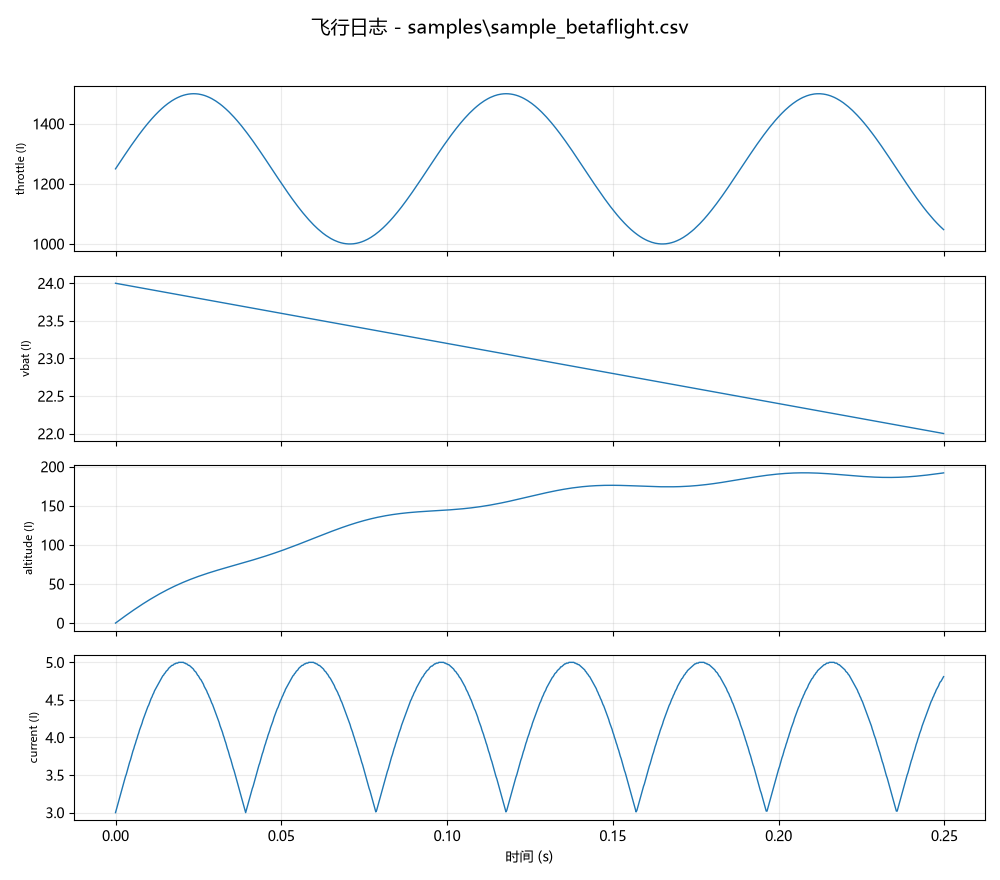

# 🛸 飞行日志查看器 Flight Log Viewer

> ✚ **小冉学长 · 出品** — "把每一次起飞，都看得清清楚楚。"


一个用于读取并可视化主流开源飞控**飞行日志**的桌面/Web 工具。

它可以把简航控（Betaflight / INAV）的 **Blackbox** 日志，以及自动驾驶（ArduPilot，
包括 ArduCopter / ArduPlane / ArduRover / ArduSub）的 **DataFlash (`.bin`/`.log`)**
二进制日志，解析成结构化数据，并以曲线图、统计摘要的形式展示。

## 为什么做这个

主流飞控大致分两类：

| 派系 | 代表固件 | 典型用途 | 日志格式 |
|------|----------|----------|----------|
| 竞速/特技 | **Betaflight** | 多旋翼花飞、竞速 | Blackbox (`.bbl` / CSV) |
| 导航/自制 | **INAV** | 固定翼、长航时多旋翼 | Blackbox |
| 自动驾驶 | **ArduPilot** (ArduCopter/Plane/Rover/Sub) | 测绘、巡检、重型机 | DataFlash (`.bin`/`.log`) |

这些日志记录了飞行中每个时刻的姿态、加速度、GPS、电池、油门、电机等数据，
是分析飞行质量、排查抖动/炸机/续航问题的第一手资料。但它们的原始格式是二进制的，
直接用记事本打不开。本项目把它们解析成人能看懂的图表。

## 功能

- ✅ 解析 **ArduPilot DataFlash 二进制日志**（`.bin` / `.log`）：自描述的 FMT 格式，
  支持全部常见字段类型（`b B h H i I f Q e E n N Z L M c`）与 legacy 缩放
- ✅ 解析 **Betaflight / INAV Blackbox CSV 日志**（`.csv`）：多会话、多帧类型，
  自动识别列名
- ✅ 解析 **Betaflight 二进制黑盒日志**（`.bbl` / `.bfl`）：实现完整的二进制帧解码
  （变长整型、ZigZag、TAG8_4S16 / TAG2_3S32 / TAG8_8SVB、EliasDelta/Gamma 编码，
  predictor 预测器），支持主帧 I / 差分帧 P / GPS 帧 G / 慢帧 S / 事件帧
- ✅ 顶层统计摘要：飞行时长、解锁次数、GPS 最高海拔、最高速度、最大电流、
  电池起止/最低电压、最大水平加速度、各通道范围
- ✅ 多通道曲线可视化（Web 交互式，可多选叠加）
- ✅ 命令行 `info`（打印摘要）与 `plot`（导出静态 PNG 曲线图）

## 真实日志测试

除了内置的合成样例，项目还使用从互联网下载的**真实飞行日志**做过端到端验证
（这些日志仅在本地测试使用，**不随 GitHub 仓库分发**，下载地址见「开源许可」章节）：

| 日志 | 来源 | 类型 | 解析结果 |
|------|------|------|----------|
| `log171.bin` (2.98MB) | dronekit-la-testdata (GitHub) | ArduPilot DataFlash | ✅ 91032 采样 / 31 通道；电池 16.5→14.9V；海拔 1892m；速度 12.2m/s |
| `sample_real_blackbox.BBL` (1.2MB) | bartoszp1992/chimeraDrone (GitHub) | Betaflight 二进制 | ✅ 17120 采样 / 49 通道；电池 15.5→14.3V；海拔 326m；速度 9.9m/s |

克隆仓库后，如需复现这些测试，用上方链接自行下载对应日志放入 `真实日志/` 目录即可。

## 安装

需要 Python 3.8+。

```bash
cd FlightLogViewer
pip install -r requirements.txt
```

依赖：`numpy`、`pandas`、`matplotlib`、`flask`

## 使用

### 方式零：Windows 一键启动（最简单，推荐）

双击项目根目录下的 **`启动飞行日志查看器.bat`**：

1. 脚本自动检测 Python（无则提示安装）
2. 自动检查并安装依赖（首次运行较慢）
3. 自动启动 Web 服务并打开浏览器

之后按 Web 界面提示上传飞行日志即可。

### 方式一：Web 交互界面（推荐）

```bash
python 主程序.py web --host 127.0.0.1 --port 5000
```

浏览器打开 `http://127.0.0.1:5000`，上传一个 `.bin`/`.log`/`.csv`/`.bbl`
飞行日志文件，即可看到统计摘要和可多选的曲线图。



### 方式二：命令行

打印统计摘要：

```bash
python 主程序.py info 飞行日志.bin
# 或输出 JSON
python 主程序.py info 飞行日志.bin --json
```

导出静态曲线图：

```bash
python 主程序.py plot 飞行日志.bin --out output.png --channels Roll Pitch Yaw Alt
```

### 生成样例日志（测试用）

```bash
python 样例/generate_samples.py
```

会在 `样例/` 下生成 `样例阿德日志.bin` 与 `样例贝塔日志.csv` 两个
模拟飞行日志，可直接用来体验软件。（数据为模拟值，不代表真实飞行。）

## 支持的日志格式详解

### ArduPilot DataFlash（`.bin` / `.log`）

一条记录(record)的字节布局：

```
0xA3 0x95 <type(1字节)> <payload...>
```

前两字节是记录头标记；每类消息的 `payload` 布局由一条 **FMT(格式) 消息** 自描述。
FMT 消息自身布局固定为 `BBnNZ`（type、length、name[4]、format[16]、columns[64]）。

`format` 字段是一串说明符，代表每个字段的二进制类型：

| 说明符 | Python struct | 含义 |
|--------|--------------|------|
| `b` / `B` | int8 / uint8 | 有/无符号字节 |
| `h` / `H` | int16 / uint16 | 短整型 |
| `i` / `I` | int32 / uint32 | 整型 |
| `f` / `d` | float / double | 浮点 |
| `Q` / `q` | uint64 / int64 | 长整型（TimeUS 用） |
| `n` / `N` / `Z` | char[4] / char[16] / char[64] | 字符串 |

解析器逐个 FMT 定义构造 `struct.Struct`，从而解出 `GPS`（经纬度/海拔/速度）、
`IMU`（加速度/陀螺）、`ATT`（姿态角）、`BAT`（电压/电流）、`MSG`（固件/事件）等消息。

### Betaflight / INAV Blackbox（`.csv` / `.bbl`）

文本日志由若干**会话(session)**组成，每次解锁(arm)一个会话：

```
H Product:Blackbox          ← 会话开始标记
H Data version:2
H firmware_type:Betaflight
H interval:250
H fieldnames:time,loopIteration,throttle,vbat,rssi,altitude,current
time,loopIteration,throttle,vbat,...
2020,1,1050,23.9,80,0.5,3.2   ← 数据行（时间单位：微秒）
```

`H fieldnames:` 之后列出各列的字段名（首列 `time`）。解析器据此把每行数值
映射成命名通道。

### Betaflight / INAV 二进制 Blackbox（`.bbl` / `.bfl`）

黑盒日志也可用**二进制压缩格式**记录（更省空间），每条记录以帧字母开头
（`I` 主帧 / `P` 差分帧 / `G` GPS / `H` GPS-home / `S` 慢帧 / `E` 事件），随后是编码后的字段。
字段的 predictor / encoding / signed 由头部 `H Field X name/signed/predictor/encoding` 定义。

本项目的二进制解码器实现了黑羊 (blackbox-tools) 的全部编码方案：
变长整型(Signed/Unsigned VB)、ZigZag、带符号扩展、`TAG8_4S16`、`TAG2_3S32`、
`TAG8_8SVB`、Elias-Delta / Elias-Gamma，以及全部 predictor（Previous / StraightLine /
Average2 / MinThrottle / 1500 / Motor0 / VbatRef / HomeCoord / Inc / LastMainFrameTime / MinMotor）。

## 项目结构

```
飞行日志查看器/
├── 主程序.py                       # 命令行 / Web 入口
├── requirements.txt
├── 飞行日志/
│   ├── __init__.py
│   ├── core.py                   # 格式自动探测 + 统一加载
│   ├── analysis.py               # 顶层数据模型与统计摘要
│   ├── plotting.py               # 静态图表导出
│   ├── parser/
│   │   ├── 阿德解析.py   # ArduPilot DataFlash 二进制解析器
│   │   ├── betaflight_parser.py  # Betaflight Blackbox CSV 解析器
│   │   └── blackbox_binary.py    # Betaflight 二进制黑盒解码器
│   └── web/
│       ├── app.py                # Flask 后端
│       ├── templates/index.html  # 前端页面
│       └── static/               # CSS / JS
├── 样例/                      # 合成样例（generate_samples.py 可再生成）
└── 真实日志/                    # 从互联网下载的真实日志 + 测试图表

## 参考格式规范

- [Betaflight Blackbox Logging Internals](https://betaflight.com/docs/development/Blackbox-Internals)
- [ArduPilot MissionPlanner DataflashLog.py（FMT 自描述解析参考）](https://github.com/ArduPilot/MissionPlanner/blob/master/LogAnalyzer/py2exe/DataflashLog.py)
- [ArduPilot 官方文档](https://ardupilot.org/)

## 已知限制

- Betaflight **二进制** Blackbox 的字节级失步重同步/值域校验尚未 100% 复刻，
  个别异常帧可能产生离群点；统计摘要做了百分位过滤，主流通道（电池/陀螺/电机/姿态）可靠。
- ArduPilot 遥测日志 `.tlog`（MAVLink 格式）暂不支持，本项目针对本地 DataFlash。
- 浏览器曲线图在数据点超过 2000 时会自动降采样以保持流畅。

## 开源许可

本项目以 **GNU General Public License v3.0**（GPL-3.0）发布。
完整许可文本见 [`LICENSE`](LICENSE)，第三方版权声明见 [`NOTICE`](NOTICE)。

### 为什么是 GPL-3.0

本项目包含从 **betaflight/blackbox-tools**（GPL-3.0）移植的二进制黑盒
解码代码，并参考了 **ArduPilot / MissionPlanner**（GPL-3.0）的 DataFlash
格式规范。根据 GPL 的传染性要求，本项目必须以 GPL-3.0 发布。

### 贡献与使用

- 你可以自由使用、修改、再分发本项目代码，但**修改后的衍生作品必须同样
  以 GPL-3.0 许可发布**，并保留版权声明。
- 引用本项目代码的软件须附上本项目许可与原始版权归属（见 NOTICE）。

### 测试数据说明（重要）

`真实日志/` 目录下的**真实飞行日志不随 GitHub 仓库分发**（已通过
`.gitignore` 排除，原因见 NOTICE）：

| 文件 | 来源 | 能否再分发 |
|------|------|-----------|
| `阿德飞行日志.bin`、`无人机样例.BIN` | dronekit-la-testdata | ❌ 无许可证，保留所有权利 |
| `多旋翼/固定翼自动测试.BIN` | ArduPilot autotest | ❌ 动态生成，无稳定许可 |
| `真实贝塔黑盒.BBL` | chimeraDrone (GPL-3.0) | ⚠️ 需附其许可 |
| `错误恢复.bbl` | blackbox-log (Apache-2.0) | ⚠️ 需附其许可 |

示例日志下载地址：
- ArduPilot 官方测试日志：<https://autotest.ardupilot.org/>
- DroneFlightViewer 示例：<https://github.com/oznotes/DroneFlightViewer/blob/main/logs/1.BIN>

`样例/` 目录下的合成样例日志（`.bin`/`.csv`）由 `样例/生成样例.py`
自动生成，系合成数据，可自由分发。

## ✍️ 作者 · 小冉学长

本项目由 **小冉学长** 制作维护 ✚

> "把每一次起飞，都看得清清楚楚。"

从飞行日志解析、Neo-Brutalist 新野兽派界面，到 3D 飞行轨迹，
一路折腾，把看枯燥的飞行数据变得直观、大胆、有味道。

—— 献给所有热爱飞行、热爱折腾的人 🚁